# Browser IPTV Player

**Your IPTV playlists, turned into a Netflix-style app for the whole household. It runs in any web browser: computer, phone, tablet or smart TV.**

You run one small server at home and add your playlists or provider accounts once. Everyone in the house opens the site, picks their profile and watches live TV, films and series. Nothing needs installing on any device.

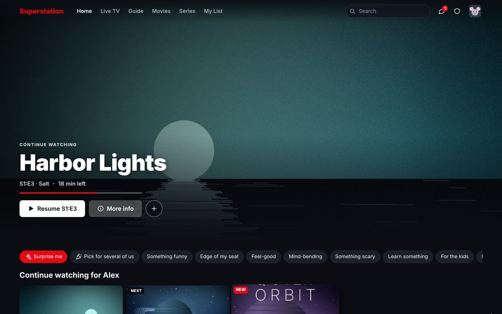

<p align="center">
  <a href="#why-this-one">Why this one?</a> ·
  <a href="#a-quick-tour">Tour</a> ·
  <a href="#quick-start">Quick start</a> ·
  <a href="#features">Features</a> ·
  <a href="#how-playback-works">How playback works</a> ·
  <a href="#configuration">Configuration</a> ·
  <a href="#security">Security</a> ·
  <a href="#faq">FAQ</a>
</p>

> **Bring your own content.** This is a player. It doesn't come with any channels, films or accounts; you add playlists or provider logins that you're entitled to use. Every title, channel, poster and person in these screenshots is made up (the demo artwork was generated for this page).

---

## Why this one?

Most IPTV players are an app you install and set up again on every device. Media servers such as Jellyfin and Plex are built around your own files, with IPTV added on the side. This project is built for a household sharing one or more IPTV subscriptions:

- **Nothing to install on any device.** Any modern browser works, including smart-TV browsers (2015 TVs onward) and phones. You can install it as an app from the browser if you like, and sign a TV in by scanning a code with your phone.
- **Set it up once for everyone.** The admin adds the playlists (M3U links or files, Xtream Codes accounts, MAC portals, Jellyfin/Emby/Plex libraries, folders of your own videos) and the TV guides. Each person just picks their profile.
- **Films and series that look like a streaming service.** Posters, plots, cast, seasons and episodes, Continue watching, My List, recommendations and "Because you watched…". The full Xtream Codes film and series catalogue is browsable, not just live channels.
- **Several providers merged into one tidy catalogue.** Duplicates are combined, even when providers name them differently, and the extra copies become automatic backups. Provider junk like `|EN| ★ Title (2023) [MULTI-SUB] 4K` is cleaned up to "Title (2023)", and a series spread across two providers gets every season from both.
- **Organised like a streaming service, not like a provider's list.** Optionally, the providers' own categories ("VOD - NEW ADDED", "|EN| ✪ COMEDY") give way to Netflix, Disney+, ABC, ESPN…, Comedy, Horror, Sports…, Christmas, Halloween…, with what's trending and popular worldwide.
- **Video goes straight from the provider to the viewer whenever possible.** Your server doesn't carry the stream, so a small box can serve a whole house. When a browser can't play a stream as it is, the browser itself (or the server) converts it automatically. An optional relay on a VPS keeps your home's address hidden from providers. When a copy fails, the others are tried all at once and the first that works plays.
- **It knows your provider's connection limit.** It shows who's using each connection, picks a copy on a provider with a free one, lets you take a connection over, and gives **priority profiles** first claim when there aren't enough to go round.
- **Made for households.** Profiles with optional PINs and age limits, Kids profiles, parental locks, messages between profiles, watch parties that share one provider connection, multiview, and a phone that works as a remote for the TV.
- **Works with the apps you already have.** Each profile can get an Xtream Codes login for TiviMate or IPTV Smarters, and Plex, Jellyfin and Emby can add it as a TV tuner, all using the same cleaned-up, merged catalogue.
- **Free and open source** (MIT). It needs no npm packages; you only need Node.js, plus ffmpeg for the conversion features.

### How it compares

|  | **Browser IPTV Player** | IPTV apps (e.g. TiviMate, IPTV Smarters) | Media servers (e.g. Jellyfin, Plex) |
|---|---|---|---|
| Install on each device | No, any browser | Yes, one app per device (TiviMate is Android-only) | Server plus apps (Jellyfin and Plex also have web players) |
| Add playlists once for the whole household | ✅ | ❌ (set up per device) | ✅ |
| Xtream films and series as a browsable library | ✅ | ✅ | Jellyfin: via plugins · Plex: no M3U/Xtream support built in |
| Several providers merged, duplicates removed, backups | ✅ | Separate playlists | Live channels only |
| Categories by network, streaming service, genre and holiday, plus worldwide trending | ✅ optional | The provider's own groups | Genres and collections |
| Video straight from provider to viewer | ✅ when possible | ✅ | ❌ (usually through the server) |
| Knows provider connection limits, takeover, priority | ✅ | ❌ | ❌ |
| Profiles, PINs, kids limits | ✅ | Varies | ✅ |
| Multiview (several channels at once) | ✅ up to 9 | TiviMate Premium | ❌ |
| Watch parties, messages, phone remote | ✅ | ❌ | Jellyfin: SyncPlay watch parties |
| Use it from other apps (Xtream login, HDHomeRun tuner) | ✅ | — | — |
| Recording (DVR) | ✅ on the server, with series recording | TiviMate Premium, IPTV Smarters | ✅ |
| Price | Free, open source | TiviMate: paid Premium for multiple playlists, catch-up and recording | Jellyfin free · Plex: free tier and paid Plex Pass; its Live TV is built around antenna tuners |

<sub>Based on each project's own documentation as of late 2026. Other apps change, so check theirs if a feature matters to you.</sub>

---

## A quick tour

<table>
<tr>
<td width="50%">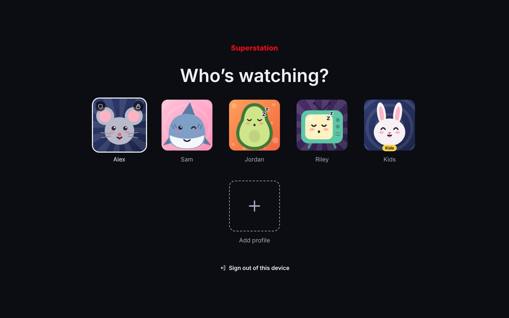<br><b>Who's watching?</b> One sign-in for the house, a profile each. PINs are optional.</td>
<td width="50%">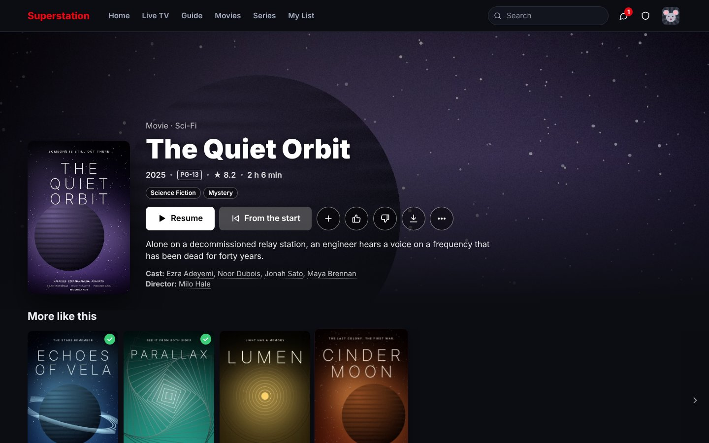<br><b>Every title has a proper page,</b> with plot, cast, rating, trailer and "More like this".</td>
</tr>
<tr>
<td width="50%">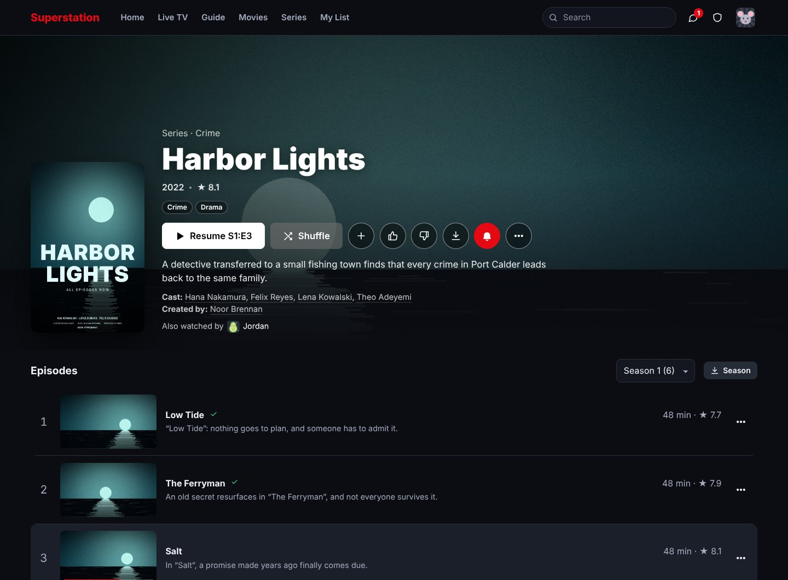<br><b>Series</b> have seasons and episodes, with progress and "Also watched by".</td>
<td width="50%">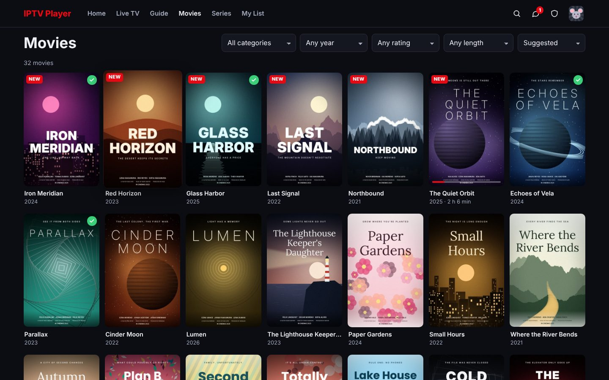<br><b>Browse and filter</b> by category, genre, decade, rating and length, or by network, streaming service, holiday and what's trending worldwide.</td>
</tr>
<tr>
<td width="50%">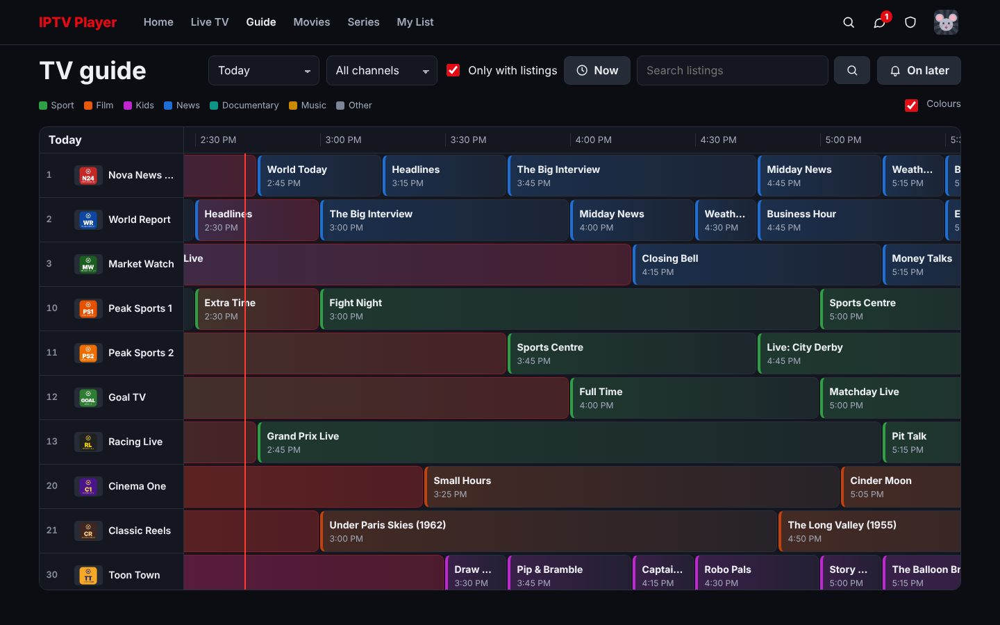<br><b>TV guide:</b> a colour-coded grid with now and next, catch-up, reminders and guide search.</td>
<td width="50%">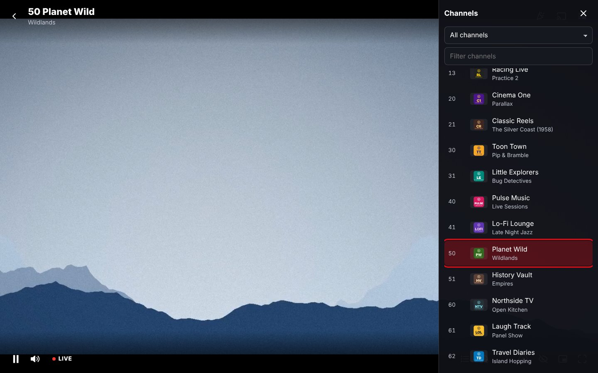<br><b>Live TV:</b> zap with arrow keys or the channel list, with what's on now.</td>
</tr>
<tr>
<td width="50%">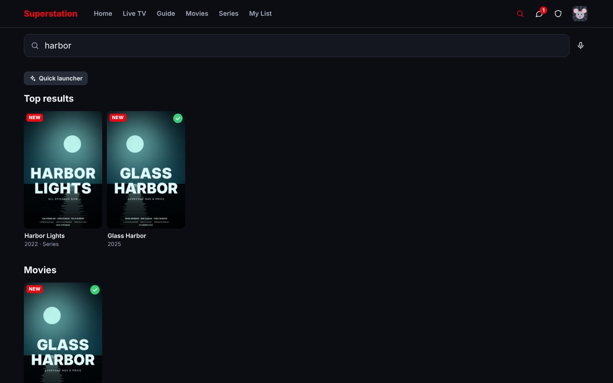<br><b>One search</b> across titles, episodes, channels and the guide. It's typo-tolerant and also understands people, genres and decades.</td>
<td width="50%">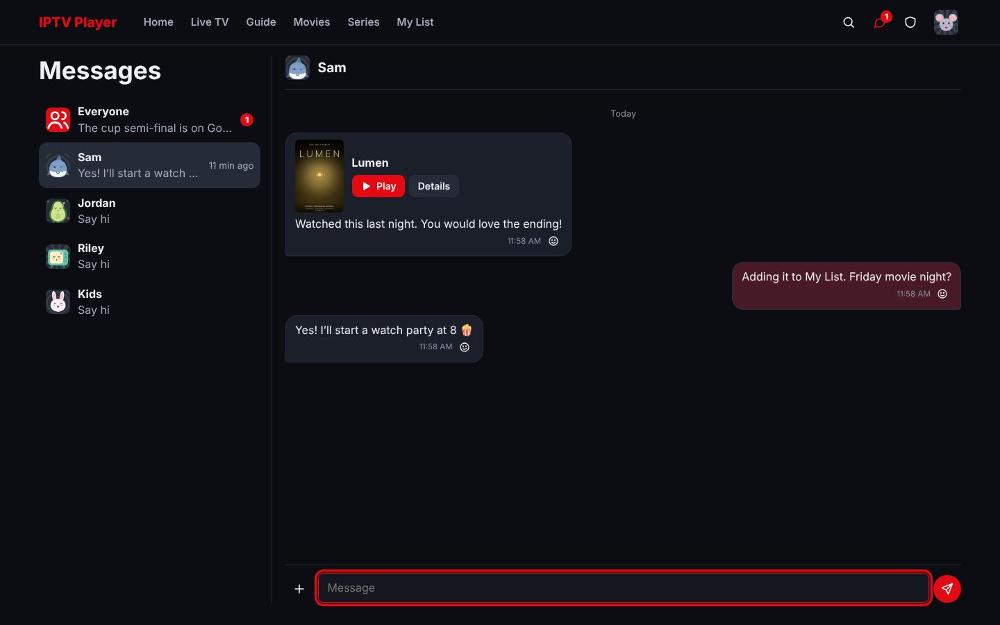<br><b>Messages</b> between profiles: share a title, react, or start a watch party.</td>
</tr>
<tr>
<td width="50%">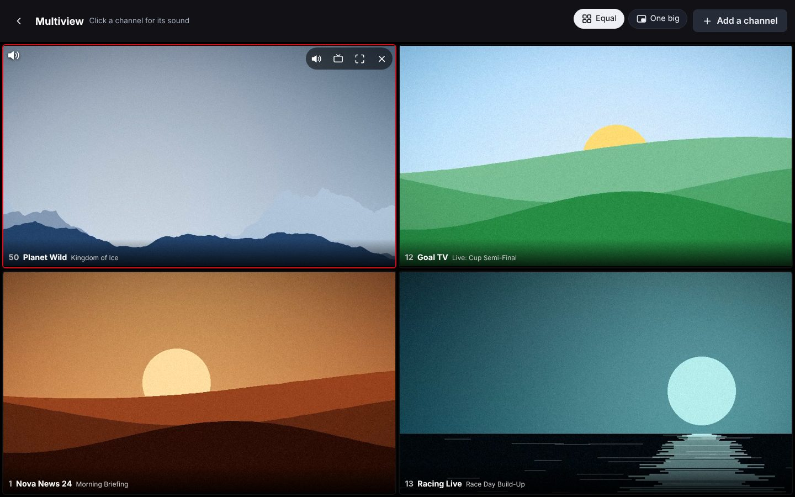<br><b>Multiview:</b> up to 9 live channels at once; sound from the one you pick.</td>
<td width="50%">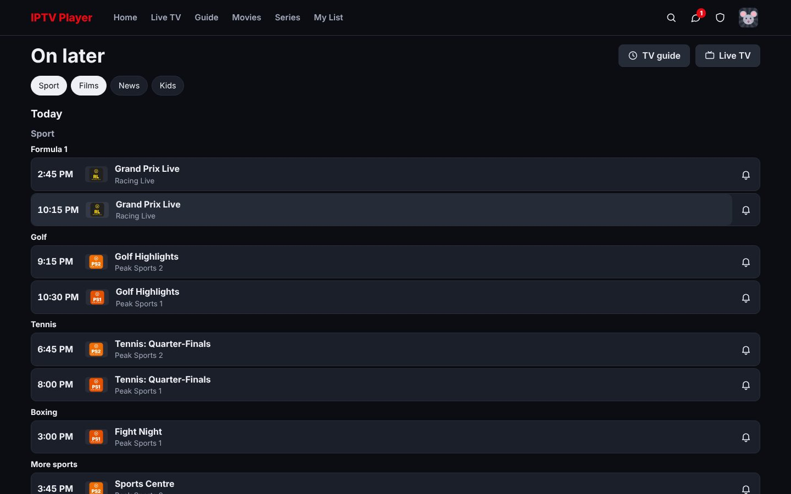<br><b>On later:</b> the films and sport coming up in the next two days, with one-tap reminders.</td>
</tr>
</table>

**Phones.** The full app works on a phone. The tab bar has Home, Live TV, Movies, Series and My List, with search and messages at the top. Any phone can also be a **remote** for the TV:

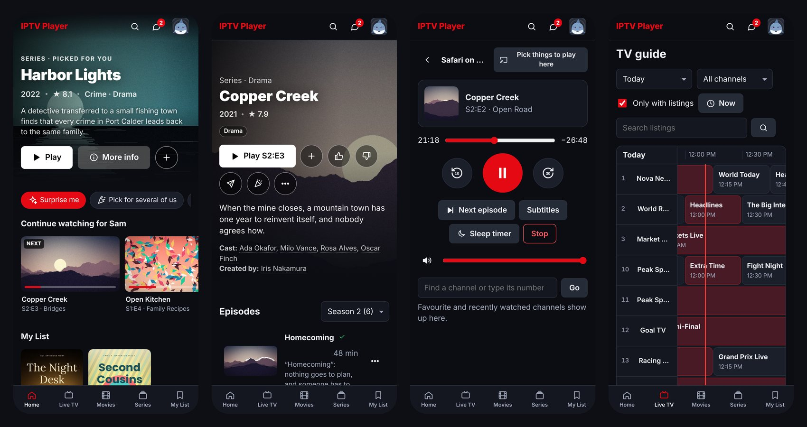

**TVs.** On a smart-TV browser it switches to a **TV mode** (big focus rings, arrow keys and remote buttons). To sign in, scan a code with your phone; there's no password typing with a remote.

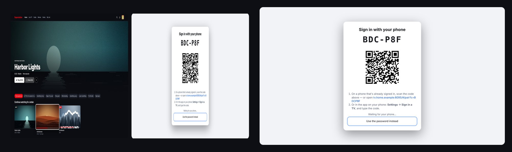

---

## Quick start

### With Docker (recommended)

```bash
git clone https://github.com/austin-72/browser-iptv-player.git
cd browser-iptv-player
docker compose up -d
```

Open `http://<this computer's IP>:8080`. Everything the app saves is kept in `./data`.

<details>
<summary>Without Compose</summary>

```bash
docker build -t browser-iptv-player .
docker run -d --name iptv -p 8080:8080 -v "$PWD/data:/data" --restart unless-stopped browser-iptv-player
```

The image includes ffmpeg. It runs as an unprivileged user and fixes the owner of `/data` on start-up. Set `PUID`/`PGID` to run as a specific host user instead.
</details>

### Without Docker

```bash
# install Node.js 22 (20 or later works) and ffmpeg, e.g. `sudo apt install ffmpeg`, `brew install ffmpeg`, `winget install ffmpeg`
node server.js            # or: npm start
```

Options can go on the command line (`--port 9000 --data /srv/iptv`) or in environment variables (see [Configuration](#configuration)).

### First run (about 5 minutes)

1. **Sign in** with the default site password **`changeme`** (or whatever you set in `SITE_PASSWORD`).
2. **Create the first profile.** It becomes the admin and must have a PIN.
3. **Open Admin** (the shield icon):
   - **Security:** change the site password.
   - **Lists:** add your playlists or Xtream Codes accounts.
   - **TV guides:** add an XMLTV guide if your lists don't name one.
   - **Languages & content:** pick the default languages, for example English only.
4. **Share the address.** Everyone else signs in with the site password and adds their own profile. You can also set **Admin → Profiles → Only the admin can add profiles**.

Nothing is shown to someone who hasn't signed in: not the brand, the channels or the profiles. They only see a plain sign-in page.

---

## Features

### Watching


- **Plays almost anything:** HLS, MPEG-TS, MP4, MKV, DASH, ClearKey DRM, and AC-3/E-AC-3 sound, from M3U, Xtream Codes or your own folders. It chooses the most direct way to play each stream (see [How playback works](#how-playback-works)). The *Stream info* panel shows which route is in use.
- **A player that gets out of the way.** The buttons and the pointer fade after a couple of seconds without a move (or at once with the *Hide the controls* button, or U); the settings open as one big panel — Playback, Picture, Sound, More side by side, each setting with a picture and what it's set to — that needs no scrolling, closes with the gear again, its close button, Back or a click outside. Tap the time left to see the time it ends instead.
- **Copies that fail are swapped fast.** When the copy playing fails or is slow to start, every other copy is tested at once (one per provider account, never on a full one) and the quickest that works plays, instead of trying them one by one. Admin → Playback turns it off.
- **A frozen picture is noticed.** When the sound carries on but the picture stops or goes black, the player switches to another way of playing it. Slow, dark scenes don't count; it waits until it has seen the picture change before judging, and on TVs whose frame counter can't be trusted it stops checking.
- **Resume anywhere.** Progress syncs live between devices, and the next episode autoplays with a countdown (an *Autoplay* switch on the screen and in the player's menu turns it off).
- **When something ends:** an episode shows the next one with its picture and story, plus *Previous episode*, *Random episode* and *All episodes*. A film shows the next film of its series first, then films like it.
- **Play queue:** *Play next* or *Add to queue* on any film, series or episode; they play one after another with the same countdown. Reorder it in My stuff → Queue or from the player; it's the same on all your devices.
- **Clear dialogue and night mode** in the player's menu: speech lifted above the music and effects, and loud scenes quieter with quiet speech louder. Remembered per profile.
- **Skip intro and skip credits.** Found automatically by comparing episodes, read from chapter names, or marked by hand.
- **Subtitles and audio tracks:** built-in, from the file or from subtitle files next to it (`Film.en.srt`, `.vtt`, `.ass`), with adjustable style. Subtitles can be set to "only when the audio isn't in my language".
- **Picture subtitles** from Blu-ray (PGS), DVD (VobSub) and DVB rips, drawn by the player itself over the picture: the server only copies them out of the file, nothing is burnt in or converted.
- **Subtitle timing:** move any subtitles earlier or later (0.1 s / 0.5 s steps, G / H keys), remembered per title.
- **Captions on live TV:** closed captions inside HLS channels and films, and DVB and teletext subtitles on MPEG-TS channels (played in the browser, or when the server converts them anyway).
- Speed 0.25–3×, frame step, seek-bar thumbnails, picture-in-picture, a mini player while browsing, bookmarks with notes, a sleep timer and *Are you still watching?*.
- **Live TV:** channel numbers, zapping with arrow keys or channel buttons, previous channel, a channel list, catch-up and timeshift.
- **Record live TV (DVR):** record a programme from the guide or a channel's schedule, *Record this* while you watch, or every episode of a series. Recordings start a minute early and run two minutes late, carry on after the provider drops, and play like your own films from **Recordings** (in your profile menu). Admin → DVR turns recording on for everyone, priority profiles only, or nobody, and sets the folder and how long recordings are kept.
- **Rewind and pause live TV** from what your device has already loaded (up to 30 minutes, nothing stored on the server), with *Go live* to jump back.
- **Multiview:** up to 9 live channels at once (2 on a phone) in a grid or "one big" layout, with sound from the one you pick. Each tile counts as a provider connection, so busy-provider and priority rules still apply.
- **Audio sync** in either direction: when the sound is early it's held back; when it's late the *picture* is held back. Remembered per channel.
- **Sound only** for live channels (radio-style, far less data), **Open in another app** (VLC, MX Player, Infuse, Outplayer and others, or a .m3u file), **Shuffle** for series, your own **skip lengths** (5–60 s), a bigger **buffer** for unreliable providers, opening on your **last channel**, and reminders that can **switch channel** by themselves.
- **Subtitles found online** when a film or episode has none in your language (on demand or automatically): SubDL and Addic7ed for free, with OpenSubtitles as the backup.
- **Downloads** for offline viewing in the browser (converted to MP4 when needed), or a plain "Save file". **Casting** to Chromecast, AirPlay (picture and sound: streams the TV can't play as they are are handed over in a form it can) and the Remote Playback API.

### Finding something to watch

- A home page with Continue watching, Top picks, "Because you watched…", New episodes, trending in the household, trending worldwide, holiday picks in season, On TV now, genre rows and mood buttons ("Something funny", "Edge of my seat"…). Every row can be hidden, pinned or reordered.
- **Recommendations** blend what the profile watches and rates, what's related (from TMDB) and what the household likes. **Surprise me** picks one title, and **Pick for several of us** finds something everyone should like and nobody has seen.
- **Search** is instant and typo-tolerant, with voice search where the browser supports it. It also understands people ("tom hanks"), genres and decades ("90s comedy"), and with smarter categories on, holidays and services ("christmas", "halloween", "netflix").
- **On later:** films and sport (by competition) coming up in the next two days, with one-tap reminders, plus an "On later today" row on the home page.
- **Follow teams and competitions** ("Arsenal", "Chiefs", "Premier League", "Formula 1"), picked from what's actually in the guide, with short forms and typos understood ("Man Utd", "Arsnal"). Their games appear in an **Events** row on Home and at the top of On later: live ones first with *Watch*, then what's next, on the best channel you can watch (HD first). Your teams' games get **reminders by themselves**, which can also switch channel. Use *Follow* on any match, or Settings → Teams and competitions.
- **Event and pay-per-view channels** (`PPV 03: UFC 310 (Sat 7 Dec 22:00 ET)`, `EVENT 12 - 2026-11-02 19:45 Arsenal v Chelsea`) get guide listings from their names, so their events show in the guide, search, On later, Events and reminders. Channels with nothing on say "No event right now" and can be hidden from Live TV.
- **Filters** by category, genre, decade, rating and length. A film page also shows its whole collection ("2 of 4 here") with *Watch in order*.
- **Trailers:** *Watch the trailer* plays inside the app, which matters on a TV where a YouTube tab is a dead end. Movies and Series also have a **Trailers** page: one trailer after another from your own lists, most popular first, to flick through with up and down (keys, remote, wheel or swipe) and then Play, add to My List or open the title. Trailers come from your provider, or from TMDB.
- **What's coming on a series:** with TMDB, a series' page shows when the next episode airs. Its season list also shows the episodes after the last one on your lists, both those still to air ("Airs Wednesday") and those that have aired but your provider hasn't added yet. Episodes show their TMDB rating.
- **Smarter categories** (optional, Admin → Categories): instead of each provider's own categories, Live TV, the guide, Movies and Series are grouped by what things are: networks and streaming services (Netflix, Disney+, Hulu, Max, ABC, ESPN…), genres (Comedy, Horror, Sports, News, Kids…), sports (Soccer, Football, Hockey, Fighting, Motorsport…), holidays (Christmas, Halloween, Thanksgiving… — the ones in season first, and always searchable: "christmas" finds the Christmas films, series and channels), themes (Superheroes, Zombies, True stories…), studios (Marvel, Pixar, Studio Ghibli…), countries and events. A title can be in several. They come from channel names, the providers' categories and labels, what the guide says is on, and TMDB: streaming services in your country, keywords, networks and studios. Movies and Series also get **Trending today and this week, Popular right now, Top rated and Out now** from TMDB's worldwide charts (not what the household watches), a *Popular worldwide* sort, and Home gets *Trending worldwide* and *Holiday picks* rows. Every kind and every category can be turned off or renamed, you can add your own, and the providers' categories can be kept alongside.
- **My List** shows what you played most recently first, then what you added or liked most recently (or A–Z).
- An optional free [TMDB](https://www.themoviedb.org/) key adds posters, plots, cast, certificates and similar titles, which streaming services each title is on, its keywords, networks and studios, how popular it is worldwide, and each episode's own title, plot, picture and air date (when a series is opened, or for many series at once in Admin → Recommendations, which also sets the language and whether new titles are looked up by themselves). Without one it uses what your provider sends.
- **Rows from lists:** add a TMDB list (Oscar winners, a director's films…), collection or keyword as a home row. It shows only what your providers have ("12 of 250 here"), and *See the whole list* shows what's missing.
- **Wishlist:** search for any film or series (with a TMDB key), even ones that aren't here, and get an alert when it arrives.

### Profiles and the household

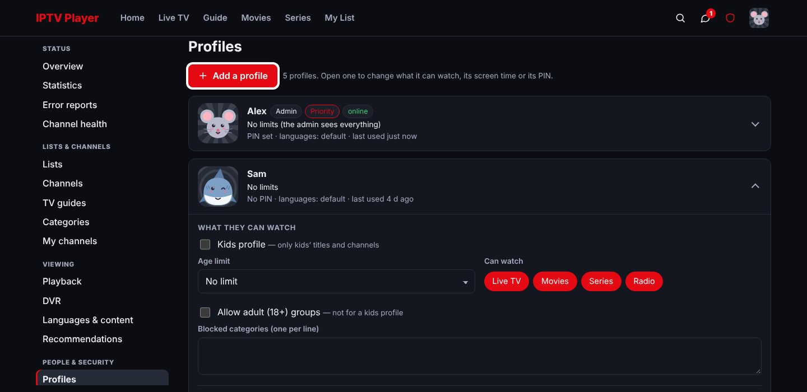

- Unlimited profiles with 142 original profile pictures, or upload a photo. Each device remembers its profile.
- **Optional PINs,** remembered on a device for 6 months or for 30 minutes, with a lockout after wrong guesses (on the device that guessed, and everywhere after many guesses across devices).
- **Kids profiles and age limits** (five levels, read from US, UK and EU ratings). Profiles can also be limited by type (live, films, series, radio) and category. Adult content is hidden unless allowed.
- Each profile keeps its own history, My List, favourites, ratings, hidden titles, home layout, theme, subtitle style and languages.
- **Busy providers:** if someone is already using the provider's connection, it says who's watching what and offers *Take over*. Titles on several providers play from the one with a free connection.
- **Admin → Profiles at a glance:** every profile is one row that says who it is and what it's limited to (*Kids' titles only · Age limit: Teens · Screen time: school days 1 h*). A row opens to that profile's settings in sections: what it can watch, screen time, priority, then its PIN and the account buttons. A change that isn't saved yet is marked *Not saved* on the row, and a profile that asked for more time opens by itself. What goes for everyone (who may add profiles, the Guest) is in its own section underneath.
- **Priority viewers:** open a profile in Admin → Profiles and tick *Priority viewer*. When a provider has no free connection, a priority viewer automatically takes one from someone on a standard profile, and that person's screen says who needed it. Standard profiles can't take a connection from a priority viewer.
- **Guest:** turn on *Offer a Guest* in Admin → Profiles and visitors get a Guest button on “Who’s watching?” (no PIN). Each visit is its own and kept in memory only. Nothing a guest watches, likes or adds to My List is saved, it's forgotten when they leave, and it never shows up in anyone's recommendations or “also watched”. Guests can't record, message, start watch parties or change profiles and settings. You can limit guests to kids' titles or an age rating, or allow adult (18+) groups for them.
- **Together:** messages with titles and reactions, shared watchlists, and **watch parties** that keep play, pause and seek in sync, with chat and emoji reactions. A party **shares one provider connection**: the server fetches the stream once for everyone in it.
- **Your channel lists:** each profile can put its favourites in its own order, make its own lists ("Football", "Kids' channels"), and choose which list Live TV and the guide open on.
- **No adult content at all:** Admin → Languages & content → *Leave out adult (18+) content for everyone* takes porn channels and films out of the catalogue altogether, for every profile (the admin too): nothing to browse, search or play, and a profile's *Allow adult (18+) groups* then does nothing. Every device loads the new catalogue straight away. The page says what counts as adult in your lists, by the providers' categories (*FOR ADULTS*, *VOD - ADULT +18*, …). Adult content is known by its category or the provider's own mark; a title that only holds a word (*Adult Swim*, *xXx: Return of Xander Cage*, *The Hustler*, a film marked *(+18)*) is an ordinary title, and no longer needs the adult permission. Something adult left over? Tick its category under *Hidden categories* on the same page.
- **Parental locks:** lock channels or whole categories behind a PIN. The server enforces it, and Kids profiles can't unlock.
- **Screen time and bedtime:** a daily limit (the same every day, school days and weekends, or each day), the hours watching is allowed and a bedtime, set in Admin → Profiles. The server counts and enforces it (all devices, parties and multiview together); viewers see what's left, get a 5- and 1-minute warning and a friendly *That's all for today* screen. They can *Ask for more time*: the admin gets one pop-up with *Give* / *Not today* on whatever device they're using (or the next time they open the app), and can also give extra time in Admin → Profiles.
- **Alerts** for new episodes of series you watch (or follow with the bell on the series page) and for wishlist arrivals: one per title, grouped when several arrive at once. They wait in Messages → *New for you* when no device is open. Each kind can be turned off.
- **Your viewing:** time watched by week, month and year, by type, top series, films, channels and genres, streaks and when you watch, compared with the period before, plus a **Year in review**. The admin sees household totals.
- **Play on another device:** send what you're watching to any signed-in screen, or use your phone as a remote. The remote has play/pause, seek, volume, subtitles, audio, channels and a sleep timer. You can also choose *Pick things to play here* on a phone so its Play buttons start on the TV. While another of your screens has the app open, a remote button appears at the top of the app on your phone (with a dot while it plays). The phone remote also has arrows, OK and Back for moving around on the TV, buttons for Home, Live TV, Guide, Movies and Series, a number pad for channels, searching by typing on the phone, and previous/next episode. Your own profile's screens connect straight away. To use someone else's screen as a remote (the admin's phone, a parent's on the kids' TV, anyone's), the phone asks first: the screen shows *Allow* / *Don't allow*. Until it's allowed, the phone doesn't see what's playing there. An allowed phone can control the screen for 12 hours, or until that screen switches profile. The screen can stop it from the toast that confirms it, and a *Don't allow* holds for a minute. On a TV, Profile menu → *Control from your phone* shows a QR code that opens that TV's remote on your phone.

### Phones, tablets and TVs

- Phone, tablet and desktop layouts. On phones the full app is there: Home, Live TV (with the guide and radio), Movies, Series, My List, search, messages, admin and every filter.
- **TV mode** turns on by itself on smart-TV browsers. Everything works with arrow keys and the remote's OK, Back, Menu/Info and media keys. The app is plain ES5 with fallbacks, so it also runs on older TV browsers.
- **Sign in a TV with your phone:** the TV shows a code and a QR code, and you approve it on a phone that's already signed in.
- **Your remote, your buttons:** Settings → *Remote and keyboard* sets what the coloured buttons, number keys, Menu/Info, media keys and a few spare keyboard keys do (guide, Live TV, last channel, subtitles, sleep timer, multiview, a favourite channel…). A *Press a button* tester shows what any button is called. Each device keeps its own; your profile's default follows you.
- **Quick launcher:** <kbd>Ctrl</kbd>+<kbd>K</kbd> (<kbd>⌘</kbd>+<kbd>K</kbd> on a Mac), a held OK on Search, a remote button, the profile menu or the button on the Search page. Type to jump to any page, admin tab or setting, switch profile, play a channel ("ch 101"), open a title, or do something ("sleep timer 30 min"). Typos are forgiven and recent picks come first.
- Installable as an app (PWA). Media keys and lock-screen controls work, and the screen stays on while playing.

### Look and accessibility

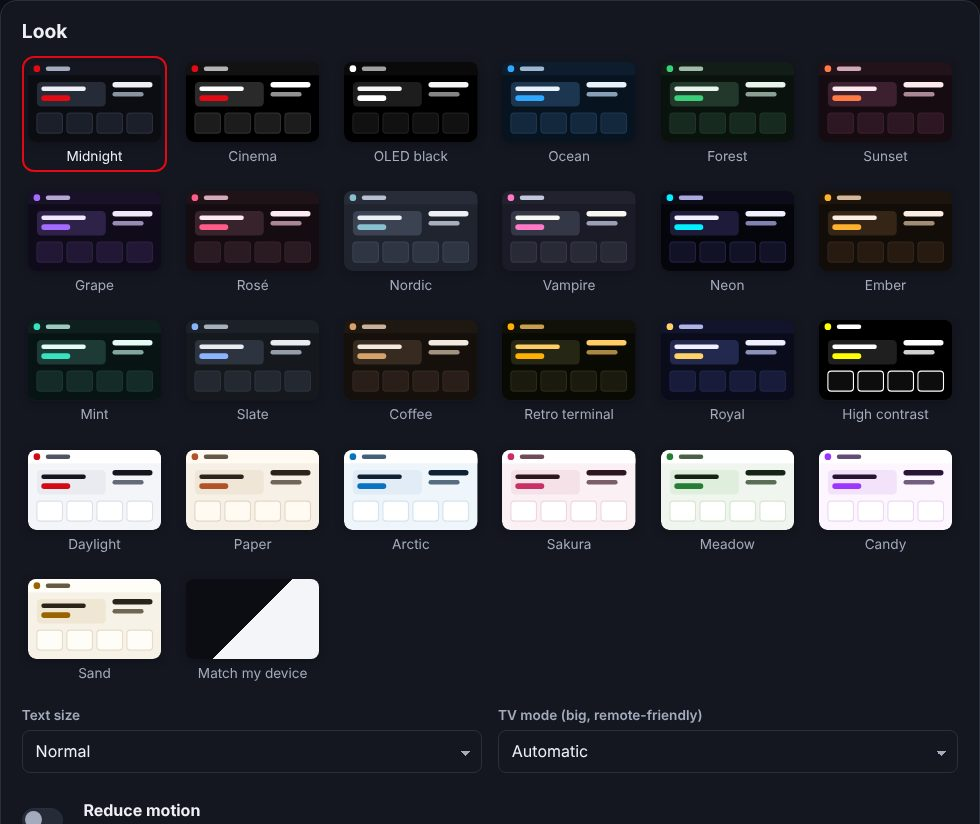

- 25 themes (dark, OLED black, high contrast, light and more), or match the device.
- **Posters with a little life:** a poster settles in with a small rock when its picture arrives, and the posters in a row lean gently as you scroll it left or right, then nod back when it stops. Settings → *Reduce motion* (or the system's reduced-motion setting) turns it off.
- **A moving background:** soft glows in the theme's colours drift slowly behind the posters, taking a minute or more to cross the screen. It's turned off on the player and the guide. Settings → Look → *Moving background* switches it off, and *Reduce motion* holds it still. TVs, games consoles and very small devices get neither the background nor the poster animations unless you turn them on there, so they stay quick.
- **Light catalogue for TVs and games consoles:** a PlayStation's browser runs out of memory on a big catalogue and the page just dies. So TVs, consoles, and any device where loading didn't finish twice in a row get a lighter one: the same titles at about half the size, sent in small pieces. Films' stream addresses are fetched when you press play, and nothing is kept on the device between visits. Settings → Look → *Light catalogue on this device* turns it on or off for that device. On these devices a catalogue update doesn't reload while something is playing, and reloads at most every 20 minutes.
- **Playing on a PlayStation or TV:** a TV's own video player fetches the stream without the page's sign-in. So on these devices the server's streams (converted ones, the relay, your own files) are given a signed address that works for a day, like the one for casting. A PlayStation is only sent H.264 video, even though it claims to play HEVC and AV1. A picture that is playing is no longer mistaken for a black screen and switched to a converted stream partway in, and a stream played as it is gets a little longer to start, since a TV's player is slower to get going.
- **Quicker to start:** when the provider has said what a film or episode is (or for a live channel), a server conversion starts straight away, with the look inside the stream running at the same time instead of first — a few seconds sooner. This briefly uses two connections, so it only happens when the account has room for two; if the look finds something else is needed (converting the picture, another audio language), the conversion starts again that way. Admin → Playback → *Start conversions quickly* turns it off. Live conversions come in 2-second pieces instead of 4, and a TV's or phone's own player waits for about three before it starts. On a PlayStation, copies the server already knows can only play through it aren't each checked first, and the signed address comes in the same answer.
- **Fewer steps before the video:** the copy order and how this device reaches the copy that goes first come in one answer. The separate check before an episode is gone too, since the server reads a series again itself when it needs to. On a TV or PlayStation (light catalogue), the stream addresses of a film whose page is open, and of everything in Continue watching, are fetched ahead, and the player comes up at once while an address is fetched.
- **Continue watching opens the page:** a film or episode in *Continue watching* opens its page, whose main button says *Resume* (for a series, *Resume S1:E3*, or the next episode), instead of starting at once.
- **More formats on more devices:** worked out by measuring — 65 sample files (the common containers, picture and sound formats, and the awkward cases) put through the server's own conversion for a device that only decodes H.264 and for one that decodes everything, checking what came out. What that found, and now does:
  - *Each device says what it decodes*, and only what it can't is converted: which formats it takes, whether its HEVC is 8-bit only, and the tallest picture it decodes (asked of the browser once). A film taller than a phone's or stick's decoder goes is brought down for it instead of failing first.
  - *AV1 and VP9 are passed on as they are* to a device that decodes them (in MP4 pieces: MPEG-TS can't carry them) — before, they were always re-encoded. HEVC goes out in MP4 pieces for Apple's own player (older iPhones, AirPlay to an Apple TV), which shows nothing otherwise.
  - *AVI files with H.264* (no picture timestamps) are copied; the copy used to stop with "first pts and dts value must be set".
  - *HDR films converted for a screen without HEVC* (a PlayStation, older browsers) are brought down to ordinary colours, where they came out grey and washed-out; Admin → Playback says whether your ffmpeg can (it needs the *zscale* filter). If that step ever stops ffmpeg, the film is converted without it.
  - *Interlaced pictures* (broadcast TV, DVD rips) are deinterlaced when converted — no more combing.
  - *Sound the server can't decode* (AC-4 on some broadcast channels): another audio track is used, else the picture plays without sound and says so, instead of the channel failing. A picture format ffmpeg can't decode says that plainly.
  - *A film from the server's copy starts where it was asked to.* The player took the copy's still-growing playlist for a live stream and started near its end — a few seconds into the film, more on a fast provider, minutes for a file on the server's own disk — and the same after a seek.
  - *The position after a seek or a resume in a copy is right.* A copy's picture can only begin at a key frame, up to ten seconds before the point asked for in many films, while its sound begins at the point: the player counted from the point, so the time shown, where it resumed, and separately fetched subtitles were out by that much, with a silent lead-in. The server now reads where the picture really starts and says so, and the player moves up to the point. (For hls.js and Apple's player; a TV's or console's own player gets its copies exactly as before.) With a provider that can't start part-way at all, the copy began at the film's start while the player showed the point asked for — now it knows.
  - A Chromecast gets a conversion of its own (H.264) when what's playing is a copy made for this device's formats.
- **The whole project, read again (seven reviews of the older code):**
  - *Keeps your data:* a data file that can't be read for a moment (a shared Windows folder saying "busy") is tried
    again and never replaced by an empty one; a restart that catches a list or guide mid-refresh no longer puts it on
    hold for 6–48 hours; restoring a backup always restarts (it could carry on and never save again) and checks the
    file whole first; a wrong file uploaded over a playlist no longer replaces it.
  - *Can't be held up or got round:* a crafted error report, a broken guide file or a gzip bomb can't freeze the
    server; the parental PIN and profile PINs lock for longer each time and count guesses across devices and
    profiles; an unlock is for the profile that entered the PIN; a kids profile can't delete itself (who may add
    profiles is the admin's choice: Admin → Profiles → *Only the admin can add profiles*); "don't remember my PIN" now ends 30 minutes after the profile was
    last used; a message between profiles can't carry code; a provider's ids can't name files outside the cache.
  - *Player:* a film that stops well before its end is picked up where it stopped instead of being marked watched and
    followed by the next episode; a browser-side conversion that was given up on is really stopped (it could later
    take over the video and kept its connections); a live channel frozen without saying so reconnects after 20
    seconds; "started muted" by the browser isn't remembered as your choice; an audio-only station isn't converted
    for having no picture; the screen may sleep when paused or finished; trailers stop when the film starts; the
    next-episode countdown waits while the page is hidden; speed keys only on films and episodes.
  - *TVs and older browsers:* arrow keys work on "Who's watching?" and the PIN pad; focused rows no longer snap under
    the top bar on Tizen/webOS up to 4; adding a profile, broad searches, menus closing on an outside press,
    reminders and pause/resume no longer fail on browsers missing newer features; reminders fire once.
  - *Relay and proxy (relay version 7 — Admin → Network → Update the relay):* the provider's connection is closed when
    the server stops reading through the relay; playlists asked for the way ffmpeg asks are rewritten; a ".m3u8"
    that is really the video isn't read as a playlist; addresses written as IPv4-inside-IPv6 are treated as the
    private addresses they are; HEAD on a proxied stream answers instead of downloading it.
  - *Admin:* a failed refresh says so (it said "Refreshed"); renaming a list doesn't download it again; a proxy's host
    can be changed with its password left masked; the User-Agent is checked; removing a guide, deleting a report and
    making a new app password ask first; Statistics shows where a converted start's time goes.
  - *Lighter on big catalogues:* recommendations aren't worked out again after every guide refresh; Home's list rows
    no longer count every matched title per row; episodes of a removed list are dropped from memory.
- **Access, tightened:** a signed stream link opens exactly what it was made for (one conversion session, one proxy
  address, one portal item — it used to cover everything under `/api/proxy`) and only reads; no link is made for a bare
  prefix; a portal (Stalker) item or a media-folder file asked for by a browser needs a profile that may watch it; a
  channel's address can't be swapped for a file on the server's disk; stopping a conversion is its owner's or the
  admin's; a remote allowed for one profile isn't allowed for another on the same phone; locked channels aren't named
  in “watching now”.
- **Starting a video, steadier:** a copy that's given up on can no longer fail a second time a moment later (which
  skipped a copy untried); checking the other copies never opens a second connection on the account being started;
  a copy's own time to start is what's remembered, not the wait for the copy before it; a conversion that's ready
  doesn't wait up to 15 seconds for the look inside; closing the player stops a conversion got ready on the side.
  An episode's copies keep their order between reads of a series (a slow provider left out of one answer used to
  renumber them, so a player's “backup 2” became another copy).
- **Second review, fixed:** a season saved as files goes one episode at a time (it took a connection and a
  conversion per episode, all at once); a head start never overlaps another or takes an account's last connection,
  and what plays next gets one in the last 90 seconds; a subtitle source that failed is asked again after a minute,
  not six hours; two fetched subtitles with the same name no longer show on top of each other; SubDL downloads are
  https-only with every redirect checked; a guide row with no listings can be left with the arrow keys; *Why?* gives
  provider details to the admin only and nothing for a locked channel.
- **Why no listings:** an empty guide row, or a channel's page with no guide information, has a *Why?* that answers
  in plain words — no guide added, the guide failed to download, no guide carries this channel, its listings ran out
  — and what to do, with the channel still a tap away.
- **A head start for Play:** opening a film's or series' page has the server look inside the file its Play button
  would start (when the account has a connection to spare), so the conversion doesn't wait 1–3 seconds for that when
  Play is pressed. Admin → Playback → *Get ready when a title’s page opens* turns it off.
- **Second look at this week's changes:** the remote follows a reloaded screen instead of dropping to the list; two
  windows of one browser are two screens again; Home keeps ordering itself when a list row is added, doesn't count
  hidden rows towards its eight, and counts each row once per visit; the live timeline holds still while dragged.
- **Buffering, explained:** when a video has waited 5 seconds, or stops for the third time in three minutes, the player
  checks the connection between the device and the server and says where the hold-up is — this device's connection, or
  the provider sending slowly — with *Try another copy* when there is one, so nobody restarts things that were fine.
  And the big banner on Home can be switched off (Customise).
- **Timeline, easier and finer:** a taller place to press and a knob that's always there on touch screens; while
  dragging, moving away from the bar (up or down) slows it to a half, a quarter, then a tenth, for landing within a
  few seconds; the time shows how far you're jumping; the mouse wheel over the bar steps 5 seconds (1 with Shift); the
  controls no longer fade out mid-drag, and a cancelled touch doesn't jump.
- **Error reports, gone through again:** an episode whose series has left the catalogue no longer breaks the player's
  Episodes panel; an answer from the proxy in front of the server (502, 520, 524 — the server restarting, a blip) is
  shown but no longer filed as a bug, and a read it answered for is asked once more first; a script that didn't arrive
  is fetched once more before saying so.
- **Home, smarter:** what you're in the middle of leads the page (*Continue watching*, how much is left, one Resume
  button; the film picked for you shows when there's nothing to resume). Rows order themselves — live TV up at the times
  of day it's watched on that device, rows you pick from up, rows never used down, new episodes at the top when there
  are some — until you move a row in Customise, after which your order stays. Recommendations share one *For you* row
  with a chip for each kind, favourite and recent channels one *Your channels* row, and the page shows eight rows with
  the rest behind *More rows*.
- **Remote, steadier:** the picture of what's playing on the remote no longer flashes (it was put in again with every
  update from the screen), a screen that reconnected shows once in the list of screens instead of once per old
  connection, and an open remote follows its screen to the new connection.
- **Slow copies remembered:** a copy the player gave up on because it hadn't started after 9 seconds (while another
  answered quickly) puts its list's copies after the others' for six hours, or until one of its videos starts in under
  8 seconds — so the next episode doesn't begin on the same slow copy. And a device whose own conversion didn't start
  in time has the server's conversion go first for six hours, instead of waiting 8 seconds on it every time.
- **Hardware encoder, checked:** the server tries the chosen hardware encoder on a half-second test picture when it
  starts and whenever the choice changes, and Admin → Playback says whether it works and, if not, why — for example no
  graphics device inside the container, which is always the case for Intel or AMD under Docker Desktop on Windows or Mac.
  One that can't work is never tried on a viewer's video.
- **Downloading a series:** a series' page has a Download button, and the episode list a *Season* one, to download a season, the whole series or the episodes not watched yet, in one quality. Episodes already downloaded are left out. Kept in the app (on https), they download one after another in Downloads; as files, the browser saves them one by one, named like *Harbor Lights S01E01 Low Tide.mp4*, and may ask once whether the site may save several. Films and single episodes download as before (their page's Download, an episode's ⋯ menu). Not on TVs and games consoles, which can't keep videos.
- **Subtitles, fixed:** their size now follows the picture on screen, 4.5% of its height at *Subtitle style → 100%*, so they're the same size against the picture in a window, full screen, on a phone held either way or on a TV. They used to be "3.2em", which each browser read differently. Lines sit just above the bottom of the picture, not the bottom of the video's box, which on a phone held upright is in the black below it. A film resumed through the server's conversion no longer shows a screen full of subtitle lines at once: ffmpeg writes times under an hour as *mm:ss*, and the ends of those weren't moved back. Subtitles fetched online (SubDL, Addic7ed, OpenSubtitles) stay on through a reload, such as a jump in a converted film or a new quality, with their times moved to match.
- **SubDL:** a title SubDL doesn't have under its TMDB number is searched again by name (and year, for a film), and a subtitle without a language field counts as the language asked for. A SubDL subtitle whose file SubDL gives as a whole address, or with spaces or brackets in its name, downloads; these were refused as "Bad subtitle" (only addresses on SubDL's own sites are fetched). A download holding only styled .ass/.ssa subtitles is shown as plain ones. When SubDL (or another source) can't search — a bad key, today's searches used up, the site down — *Find subtitles* says so under the results, and the server log says so once an hour, instead of the source being left out silently.
- **Conversions from the relay's copy:** with the stream relay on, the server converts films and episodes from the relay's own copy of the whole film — the same one devices play from — instead of reading the stream through it as it comes. A film is fetched from the provider once, at full speed; the conversion starts on what's already there and jumps within it at once; and the provider connection is free again once the film is all in. (Live channels are converted as before. The relay itself doesn't convert anything.)
- **A slow copy doesn't hold things up:** when a title has several copies and the one starting hasn't begun after 2 seconds, the server checks the others at once and answers 1.5 seconds after the first one responds (a copy still silent counts as slow). If the current copy's provider isn't answering, or answers more than three times slower than another, the player switches to the quick one, usually around 5 seconds in, instead of sitting out timeouts of 12 seconds to a minute. The server also remembers providers that have been very slow (over 8 seconds) or silent in the last ten minutes, and tries their copies last; failed plays stay Channel health's to rank, as set in Admin.
- **Aiming for under 10 seconds:** each way of playing gets a short time before the next is tried: 8 seconds playing straight from the provider (12 on a TV), 8 for converting in this browser (it was 45, and on iPhones it could hang that long), 12 through the server, 30 for the server's conversion. When the way being tried hasn't started after 4 seconds and a server conversion comes next, the server starts getting it ready at the same time, so it's there if needed; it's ended at once if not. (Only when the provider allows a second connection, or the film comes from the stream relay's own copy.) On iPhones and iPads the server converts first, and the browser's own conversion comes after.
- **What it's doing while it starts:** the loading screen says each step — connecting to which provider, which copy (*Copy 2 of 5*), whether the server is repackaging or converting it, why it moved on from the last way or copy — with a running count of seconds, and when it's slow, what's being done about it.
- **Time to start, measured:** each play reports how long it took from pressing Play to the picture. Admin → Statistics → *Time to start* shows the average, how many started within 5 seconds, and the slowest providers. A start over 15 seconds also files a *Slow to start* error report with what each step took.
- **Next episode straight away:** a series' episodes are asked for the moment an episode is chosen, and asked for once. The Next button is there from the start; pressed before the list has arrived, it goes as soon as it has. A series on several lists no longer waits for the slowest provider: once one copy has answered, the others get 2.5 seconds, and a copy left out is in the next answer.
- **The player's settings, all checked:** choosing a backup in *Source* works again (it did nothing while quick switching was on). *Sleep timer → End of this video* says so instead of "1 min left". *Screenshot* of a stream played straight from the provider is taken by the server, full size. *Volume boost* on such a stream switches it through the server's relay, as Clear dialogue and Night mode do. At the end of a film, the *You might like* pictures are fetched in its last two minutes, and one that won't load shows the title instead of an empty box.
- **Smoother on big catalogues:** Home's *Something different* row picks its titles directly instead of shuffling the whole catalogue (a quarter of a second of every visit, on a slow device). Only the posters on screen swing as a row scrolls, each with its own small animation run by the graphics chip. A gap of over 2 minutes is no longer reported as a frozen page: an iPhone's home-screen app goes on saying it's on screen while it's asleep.
- **Through a restart:** a player that was going when the server restarted (an update being applied) waits for it to come back and carries on, instead of trying every copy and giving up. An episode it was playing is read again from its series. Episodes are only read from the provider when a series is opened, so before this a restarted server answered *That isn't available* for it. An episode or film that really isn't there any more is said so straight away.
- Keyboard access everywhere, labelled controls and visible focus, reduced motion, adjustable text size and subtitle styling.

### For the admin

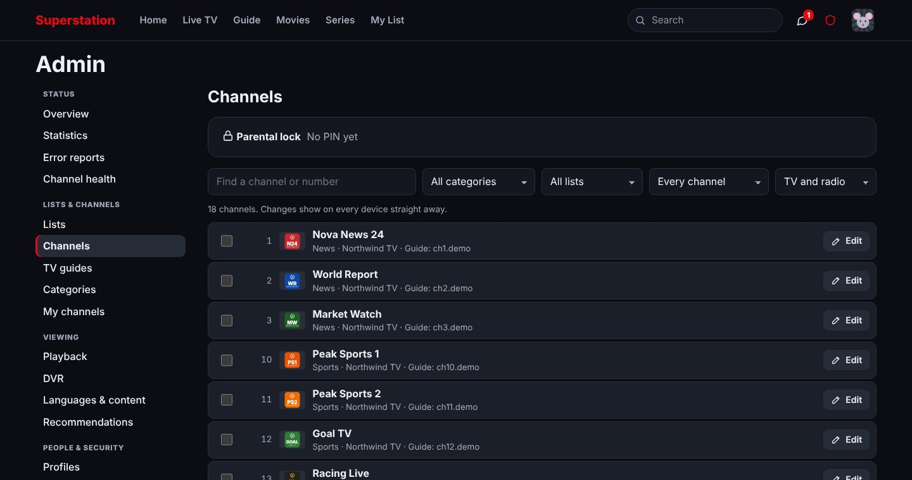

- **Lists:** M3U/M3U8 links or uploads (gzip, any text encoding), Xtream Codes (live, films and series, with an M3U fallback), and folders of video files on the server. Lists are merged in the order you choose and refresh automatically.
- **Provider accounts:** expiry, connections allowed and in use, with a warning two weeks before an account runs out.
- **How many streams at once?** The pulse button on a list tests the provider's real limit for live TV, series and films (up to 6 each). It finds where the provider refuses another connection or cuts an older one off, and uses that result from then on.
- **More kinds of lists:** MAC portals (Stalker/Ministra), and Jellyfin, Emby or Plex libraries, whose films and series play straight from the media server.
- **Channel editor** (Admin → Channels): rename, renumber, re-logo, recategorise, reorder, hide and lock channels, singly or in bulk; pick a channel's guide by hand and shift guide times; channels with no listings get placeholder blocks. Changes survive list refreshes.
- **Channel health** (Admin → Channel health): every play counts toward each channel's and provider's record (what worked, by which route, and the error when it didn't), so you can see providers' 7-day success rates, the channels failing now and which backups work. Hide a dead channel or play its backup first in one click. An optional night-time checker tests channels one at a time, only when that provider is free, and stops the moment someone presses Play. Channels that keep failing get a small "may be down" mark in Live TV and the guide.
- **Find guides and logos** (Admin → TV guides): suggests guides and logos for channels that have none, from the free iptv-org and epg.pw databases, with how sure each match is. Nothing changes until you accept a match.
- **Your own 24/7 channels** (Admin → My channels) made from a category, genre, collection or titles you pick, with a guide. They play with the normal player, so there's no extra work for the server.
- **Clean-up rules:** category rename, merge and hide rules, language detection from tags and prefixes (`EN|`, `[FR]`, `(DE)`) — and, for a film or series whose language a provider only hints at (a whole category marked "EN", or nothing), TMDB's original language, so a Korean film in "|EN| FOREIGN MOVIES" is shown to the profiles that watch Korean (not for cartoons and children's titles, which are usually dubbed; Admin → Languages & content) — and fixes for wrong posters ("Wrong poster or details?" on any title fixes it for everyone).
- **Huge lists:** titles in languages nobody in the household uses (no profile, and not the server default) are left out of the catalogue altogether, so a provider with millions of titles in a dozen languages costs only what you can watch; adding a language brings them back after a rebuild of a few minutes. The catalogue goes to devices 100,000 titles at a time (live channels first), so the app opens before it has all arrived. Admin → Lists shows each list's live channels, series and films with duplicates combined, and how many only that list has.
- **Duplicates and names:** the same film or series in copies the household watches the same way (English, multi-language, "English dubbed") becomes one entry, its own-language copy playing first and the others as backups; a series built from a playlist's episodes joins the provider's series of that name, with each episode once; a channel listed without a country joins the one country that name has ("USA" and "US" are one). A country tag keeps "The Office (US)" and "(UK)" apart. Shelf tags in front of names ("VIP| ", "TV| ", "NA - ", "EN| " on series), language tags at the end ("_msub", "_fr", "-esp"), stream notes ("[Geo-blocked]", "[EVENT ONLY]") and quality marks ("ᴴᴰ", "Ⓖ") come off; editions such as "(IMAX)" become a note; numbered event channels ("US (ESPN+ 310) | Pacific vs. Denver …") show the channel with the game beside it. Titles that are the same TMDB entry are one title whatever each provider calls them ("BMF" / "Black Mafia Family", "Bloodsport 2" / "Bloodsport II", "Austin Powers 2: The Spy Who Shagged Me" / "Austin Powers: The Spy Who Shagged Me", "Dr. Seuss How the Grinch Stole Christmas"), with every copy — two from the same list too — as a source, and take TMDB's title — when the match is sure: TMDB's title is clearly the provider's, or someone picked the entry by hand. Parts of one event stay apart ("UFC 311 (Prelims)" and the main card). A title with no year isn't matched to a film that came out after the list had it ("Resident Evil" added in 2020 isn't the 2026 film), and a provider's TMDB number for another film years apart ("Fall" from 2022 given "Fall 2: Deadpoint"'s) is ignored and the name looked up instead. Tags after the year ("Hope - 2026 CAM SUB") come off, a name one letter off TMDB's ("Hopeu") counts as the same, and copies of one film in two languages the profile watches ("L'Étrange Noël de monsieur Jack" and "The Nightmare Before Christmas") are shown once, in the profile's own language.
- **Overview and statistics:** a live *Providers and watching now* dashboard: each provider with its account (status, expiry, connections allowed and in use) and what each device plays from it — how (direct through the stream relay, or why the server carries it), bitrate, buffering and dropped frames — server conversions, playback routes used, and time watched. **Watching at once** shows how many streams each provider served at the same time (counted every minute), its busiest moments, a week grid of when it's busiest, and how long each account sat at its connection limit or turned someone away, so you can tell when you need more connections. **Test my connection** checks each device's speed to the server and the provider.
- **Playback settings:** routing (*direct first*, *always through the server*, *direct only*), *switch to a working copy quickly* (when the copy playing fails or is slow to start, the others are tried all at once and the quickest one that works is used), transcoding limits, hardware acceleration (VAAPI, QSV, NVENC, VideoToolbox), and HTTP/SOCKS5 proxies per list.
- **Stream relay:** run a small relay on a VPS of your own and viewers' direct streams go through it instead of straight from the provider. The provider never sees your home's or viewers' addresses, your server still carries no video, and streams that need special headers or block web players play directly too. The relay can also reach providers through your proxies (each list's own, or one you pick) or through a VPN (any service gluetun supports, with a kill switch), so providers see the proxy's or the VPN's address. Films and episodes are fetched whole onto the relay's disk, and several people can watch films from an account that allows only one connection: the relay shares it, keeping 10 minutes ready for everyone, and Statistics shows when it couldn't keep up. Everything this server reads from those providers goes through the relay too (conversions, downloads, recordings, other apps, channel checks), and streams a browser can't play as they are are converted in the browser when it can. See [the stream relay](docs/stream-relay.md).
- **Other apps:** an **Xtream Codes login per profile** for TiviMate, IPTV Smarters and other apps, an **HDHomeRun tuner** for Plex, Jellyfin and Emby, and the merged list and guide as M3U/XMLTV links.
- **API & automations:** API keys with scopes, and signed webhooks, for Home Assistant and scripts (what's playing, play on a device, pause, change channel…).
- **Error reports:** when something goes wrong on any device (a bug, a title that won't play, a frozen page, an app that won't start on an old TV), the device tells the server automatically. Each report has the error with the file and line of code, the device and browser, what was playing and how each way of playing it failed, and the last clicks, keys, pages and server calls before it. Admin → **Error reports** groups them, shows how often and on which devices, and has *Copy report* and *Mark fixed*. Viewers can also send their own with **Report a problem** in the player ("Won't play", "No sound"… plus a note), shown with their note on top. Passwords, PINs and stream logins are never included.
- **Backups:** nightly backups (kept in `data/backups`), plus one-click backup and restore of all settings and profiles.
- **Quick restarts:** the finished catalogue is saved (`data/catalog.snapshot`, left out of backups), so a restart puts it back in seconds instead of reading every list and putting millions of entries together again; devices that already have it don't download it again. When something it's made from changed (a list, a setting, an update), it's built again in the background while the saved one is used. Big lists are read on a separate thread and guides in the background, reading only the channels your lists use, so the server keeps answering while they load (guides over 512 MB used to be skipped and downloaded again at every start).
- **Never a blank page:** a small front process holds the web port. While the server starts or restarts, visitors see “Back in a moment” (the page carries on by itself), and when the server stops after an update the front starts it again straight away. `NO_RESPAWN=1` turns it off.
- **Updates without restarts:** with the app folder mounted (see `docker-compose.yml`), new web-app files are picked up and open pages reload. New server files wait until *you* restart; the server never restarts on its own unless you set `SELF_RESTART=1`.

**More detail:** [Watching: player extras, multiview and watch parties](docs/watching.md) · [Channels, the guide, your lists and parental locks](docs/channels-and-guide.md) · [More lists, 24/7 channels and other apps (Xtream login, HDHomeRun)](docs/sources-and-other-apps.md) · [Subtitles, rows from lists, wishlist and alerts, your viewing, dashboard, speed test, error reports and automations (Home Assistant)](docs/integrations.md) · [The stream relay: direct streams without showing your address](docs/stream-relay.md)

---

## How playback works

Web IPTV players often fail because the browser blocks video from another site unless that site allows it (CORS), and many providers don't. This player checks what the browser would be allowed to do, provider by provider, and then uses the most direct route that works:

| Route | When it's used | Server load |
|---|---|---|
| **Direct** | The provider allows web players, or the browser's own player can play it (MP4, and HLS on Safari, Android, TVs and current Chrome/Edge) | None |
| **Direct video, playlist via server** | Only the playlists are blocked; the video still comes straight from the provider | A few KB |
| **Another copy, direct** | This copy can't play directly but another provider's copy of the same title can | None |
| **Converted in the browser** | MKV/TS files, or sound browsers can't play (AC-3, E-AC-3, FLAC), converted inside the page with [Mediabunny](https://mediabunny.dev) | None |
| **Through your stream relay** | When you run one (Admin → Network & proxies): every direct stream, so providers never see your home's or viewers' addresses | None (the relay carries it) |
| **Relayed by the server** | Streams that are blocked completely, need special headers, or are http on an https page | Bandwidth only |
| **Converted on the server** | What's left: DTS sound, AVI/WMV/Xvid and other formats browsers don't play, UDP/RTMP, or a quality you picked. ffmpeg repackages what the device can decode (H.264; HEVC, AV1, VP9 where it has them) and re-encodes the rest | CPU |

<details>
<summary>The details, for the curious</summary>

Before playing, the server asks the provider exactly what the browser would be told: the same Origin header, every redirect hop, and the playlist and segments checked separately. It remembers the answer per provider, so zapping doesn't open extra connections.

1. **Direct, full controls.** The provider allows web players. hls.js, mpegts.js or Shaka read the stream straight from the provider. If a redirect is what blocks it, the browser is given the final address instead.
2. **Direct, built-in player.** No permission needed: MP4/WebM films play in every browser, and HLS plays on Safari, iPhone/iPad, Android, most smart TVs and current Chrome/Edge.
3. **Direct, HLS copy.** A raw MPEG-TS channel from an Xtream Codes panel is also offered as HLS (`/live/user/pass/123.m3u8`), which the browser's own HLS player tries even when the account doesn't list HLS.
4. **Direct video, playlist via the server.** When only the playlists are blocked, the server passes on the playlist text and the browser fetches the video itself.
5. **Another copy, direct.** The player checks up to three other copies (other providers) for a direct route first, skipping any whose connection someone in the household is using.
6. **Converted in the browser.** MKV and MPEG-TS films and episodes, and files with AC-3, E-AC-3 or FLAC sound, are read straight from the provider and remuxed in the page. The picture is copied (or re-encoded when the browser can't take it) and the sound becomes AAC or Opus. This needs WebCodecs (Chrome, Edge, Safari 16.4+, Firefox 130+) and a provider that lets web pages read its files. Turn it off for a profile with the `noBrowserConvert` preference.
7. **Through the server (relay).** The last resort for streams that are blocked completely, need special headers, or are http on an https page. It still uses one provider connection per viewer, as direct would.
8. **Convert on the server.** For DTS sound, live channels with AC-3 sound, UDP/RTMP, a quality you picked, or a provider that doesn't let web pages read its files.
9. **Backup sources.** When the same channel or title is in several lists, any copy can take over. When the one playing fails or hasn't started after a few seconds, the server tests the others at the same time (through the relay when there is one, one per provider account, never on an account that's full) and the player goes straight to the quickest that works.

**Which copy plays first.** For films and episodes the browser says what it can play by itself (MKV, HEVC, Dolby sound, in-browser conversion), and the server ranks each copy using the codecs the provider reports.

**http streams on an https site.** Browsers refuse plain-http video on an https page unless the viewer allows *insecure content* for the site (Chrome/Edge: the icon left of the address → Site settings → Insecure content → Allow). The player checks for this and then plays such streams directly. *Settings → http streams* shows the state and the steps. You can also set a plain-http *direct address* in Admin → Network & proxies, which devices switch to for http-only providers.

**Direct streams helper.** On desktop Chrome, Edge, Brave or Opera, an optional small browser extension (in `extension/`, download it from Settings → Direct streaming) makes every stream direct. It only adds the permission header to responses for requests made by this site's pages.

**Downloads, casting and audio tracks.** Downloads come straight from the provider when it allows it, either as they are or converted to MP4 in the browser. Casting gives the Chromecast the provider's own address when it can play it. Sound tracks are switched by the browser itself, or by the in-browser conversion.

**Provider accounts that allow one connection.** The server never opens a second connection while someone might be watching. Preview pictures, track reading and intro detection are switched off for those titles; intro detection needs 3 or more connections.

Still needing the server: streams that need headers browsers can't send, an admin's proxy for video, RTMP/RTSP/UDP, DTS sound, subtitles stored inside a file (picture ones are only copied out; the browser draws them), your own media folders, and background work such as preview pictures and intro detection.
</details>

---

## Configuration

Almost everything is set in the **Admin** screen and saved in `data/`. These are the start-up options:

| Environment variable | Default | What it does |
|---|---|---|
| `PORT` | `8080` | Port to listen on (or `"port"` in `defaults.json`, or `--port`) |
| `HOST` | `0.0.0.0` | Address to listen on |
| `DATA_DIR` | `./data` (`/data` in Docker) | Where accounts, lists, caches and history are stored |
| `SITE_PASSWORD` | `changeme` | The site password used the very first time. After that, change it in Admin → Security |
| `ALLOWED_HOSTS` | — | Extra host names to answer to while the default password is still in use (see [Security](#security)) |
| `TRUST_PROXY` | off | Set to `1` behind a reverse proxy, so the real client IP and https are used (the last address in X-Forwarded-For that isn’t local or Cloudflare’s) |
| `HTTPS_CERT`, `HTTPS_KEY` | — | Paths to a certificate and key, so the server speaks https itself |
| `HWACCEL` | — | `vaapi`, `qsv`, `nvenc` or `videotoolbox` for hardware transcoding. Tested when the server starts; falls back to software if it fails. Docker Desktop on Windows or Mac can't pass Intel or AMD graphics through |
| `VAAPI_DEVICE` | `/dev/dri/renderD128` | Render device for VAAPI |
| `FFMPEG_PATH`, `FFPROBE_PATH` | `ffmpeg`, `ffprobe` | Where ffmpeg is installed if it isn't on the PATH |
| `MAX_MEMORY_MB` | 60% of RAM (4–12 GB) | Memory limit for the server; big catalogues and guides need room |
| `SELF_RESTART` | off | Set to `1` to let the server restart itself after an update |

### Branding

**Admin → Brand** sets the site name, logo and accent colour. To ship a build that's already branded, put a `defaults.json` next to `server.js` (see `defaults.example.json`):

```json
{ "brand": { "name": "Our TV", "accent": "#e50914" }, "sitePassword": "something-better" }
```

`defaults.json` only sets starting values. Anything changed in Admin takes priority.

---

## Security

- The site password and PINs are hashed (scrypt). Sessions are http-only cookies, and sign-in attempts are rate-limited.
- Every API request needs a custom header, so other websites can't act on your behalf (CSRF).
- **Until you change the default password,** the server only answers on localhost, private IP addresses and `.local` names, plus any names in `ALLOWED_HOSTS`. Once you change it, any host name works.
- Streams are relayed through signed, expiring links only.
- **To use it outside your home network,** put it behind https. Casting, installing as an app and in-browser downloads also need https (or localhost):
  - **Tailscale:** the easiest, private with no open ports. `tailscale serve --bg 8080` gives you an https name.
  - **Caddy:** `tv.example.com { reverse_proxy 127.0.0.1:8080 }`, then set `TRUST_PROXY=1`.
  - **Built in:** set `HTTPS_CERT` and `HTTPS_KEY`.

## Data

Everything lives in `DATA_DIR`: `accounts.json`, `settings.json`, `lists/`, `epg/`, `users/<profile>.json` (with saved recommendations in `users/<profile>.recs.json`), `markers.json`, `social.json`, `channels.json` (channel edits and locks), `mychannels.json` (24/7 channels), `outputs.json` (Xtream logins and tuner), `integrations.json`, `apikeys.json`, `webhooks.json`, `error-reports.json` (with a readable copy, `error-reports.txt`), `screentime.json` (screen time rules, today's minutes and requests for more time), `homelists.json` (home rows from lists), `wishlist.json` (wishlists, followed series and alerts), `viewing/<profile>.json` (daily viewing totals), `follow.json` (teams and competitions each profile follows, and the event-channel setting), `health.json` (channel health counters and settings), `concurrency.json` (streams at once per provider: every minute for 48 hours, hourly for 120 days), `guidefinder.json`, `dvr.json` (recordings, series rules and DVR settings; the recordings themselves go in `recordings/` unless Admin → DVR names another folder), `catalog.snapshot` (the finished catalogue, for quick restarts; rebuilt by itself, safe to delete), `tmdb-map.json`, `meta/` and `meta-eps/` (which TMDB entry each title is, and its details and episodes) and `cache/` (including `cache/homelists/` and `cache/publicdb/`, the public guide and logo lists, refreshed weekly). Secrets in these are stored hashed where they only need checking (passwords, API keys). Files are written atomically, with a `.bak` copy. Back up the folder, or use Admin → Other apps & backup.

## Limits

- Converting on the server uses CPU. A small machine can handle a few transcodes at once; repackaging costs very little. **Admin → Playback** sets the maximum.
- DRM: ClearKey works, and so does Widevine/PlayReady where the browser supports it and the playlist provides a licence URL. Nothing is decrypted on the server.
- Casting to Chromecast falls back to the server's address when the Chromecast can't play the provider's, so the server must be reachable from the Chromecast.
- Intro detection needs at least two episodes of a season.
- The PlayStation browser has no Web Audio, so Volume boost, clear dialogue, night mode and holding the sound back aren't offered there, and its player fetches streams without the page's sign-in, so the server's own streams are given signed addresses there.
- Smarter categories work from what each provider and TMDB say: a title with no TMDB details yet is grouped by its genres and its provider's category until the details come in.
- A recording holds one of the provider's connections for as long as it runs, like a viewer. When none is free at the start time it waits, and gives up if none comes free before the programme ends.

---

## FAQ

**Does it come with channels?**
No. You add your own M3U playlists, Xtream Codes accounts or video folders.

**What does the server need?**
Very little bandwidth or CPU when streams play directly: any machine that runs Node.js 20 or later or Docker, such as a mini PC or a NAS. Memory depends on the size of your lists: a few GB for very large provider catalogues and TV guides. Server-side conversion needs ffmpeg and some CPU, or a GPU with hardware acceleration.

**Will it use up my provider's connections?**
It's careful with them. It never opens a second connection while someone might be watching, shows who is using each one, and lets you test the real limit (Admin → Lists → pulse button). Priority profiles get first claim.

**Which browsers work?**
Current Chrome, Edge, Firefox and Safari on computers and phones, and smart-TV browsers (Samsung Tizen, LG webOS, Android TV, Fire TV) back to about 2015.

**Can I use it with VLC, Kodi or TiviMate too?**
Yes. Turn on the Xtream Codes login in Admin → Other apps and sign TiviMate or IPTV Smarters in with a profile's login, or add it to Plex, Jellyfin or Emby as an HDHomeRun tuner. There are also plain M3U and XMLTV links for VLC and Kodi. See [using this with other apps](docs/sources-and-other-apps.md).

**Why do I see the same film twice?**
Usually because providers name it differently and nothing says they're one film yet. Copies become one title when TMDB matches them to the same entry and the match is sure (the names clearly agree, or the year agrees with the provider's own TMDB number); a provider's number that points at a film from years earlier or later is ignored. New matches are put together the next time the catalogue is built, which happens by itself after the TMDB lookup. If two titles still show, "Wrong poster or details?" on the wrong one fixes it for everyone.

**Can it group things by Netflix, Disney+, Hulu and so on?**
Yes: turn on **Smarter categories** in Admin → Categories. Live TV, the guide, Movies and Series are then grouped by network and streaming service, genre, sport, holiday, theme and studio, with Trending, Popular and Top rated from TMDB. Each kind and each category can be turned off or renamed, and you can add your own.

**Can it record?**
Yes. Record a programme from the guide or a channel's schedule, *Record this* in the player, or *Every episode* for a series. The server saves the stream as it comes (no converting), so it needs ffmpeg and disk space, not CPU. Each running recording uses one of the provider's connections. Admin → DVR sets who may record (everyone, priority profiles only, or nobody), where recordings go and how long they're kept.

---

## Keyboard shortcuts

<details>
<summary>Player keys (press <kbd>?</kbd> anywhere to see them in the app)</summary>

| Key | Action |
|---|---|
| Space / K | Play / pause |
| ← / → | Back / forward by your skip length (10 s unless you change it; Shift: 60 s) |
| J / L | Back / forward by your skip length |
| ↑ / ↓ | Volume (live TV: change channel) |
| , / . | Frame step |
| < / > | Speed |
| F, M, P | Fullscreen, mute, picture-in-picture |
| C / A | Subtitles / next audio track |
| G / H | Subtitles 0.1 s earlier / later (live TV: Shift+G, as G opens the guide) |
| S | Skip intro or credits |
| N | Next episode (or the next thing in your queue) |
| B | Bookmark here |
| I | Stats (live TV: what's on) |
| X / G | Previous channel / guide (live TV) |
| / | Search (outside the player) |
| Ctrl+K / ⌘K | Quick launcher: pages, settings, channels, titles and actions |
| ? | Show these keys |
| Menu / Info (remote) | Options for the highlighted poster or channel (My List, hide, download…) |
| Esc / Back | Close |

On a TV remote, hold OK on Search for the quick launcher. The coloured buttons, number keys (outside live TV), Menu/Info and media keys can be given other jobs in Settings → Remote and keyboard.

On phones, double-tap the left or right side of the video to skip back or forward, and swipe up or down on live TV to change channel.
</details>

## Development

```bash
DEV=1 node server.js        # rebuilds the front-end bundle on every request
npm test                    # unit tests (language detection, playback checks, duplicates, guides, connection test…)
python3 test/ui/tvreach.py http://localhost:8080   # checks everything can be reached with a TV remote
```

The front end is plain JavaScript and CSS in `web/`, with no build step. Files are joined in the order given by `web/order.json`, and the code avoids optional chaining (`?.`) and `??` so older TV browsers can run it.

## Licence

MIT. Bundled players: hls.js (Apache-2.0), mpegts.js (Apache-2.0) and Shaka Player (Apache-2.0). In-browser conversion uses Mediabunny and its AC-3 decoder (MPL-2.0). All of them are in `public/vendor/`.
